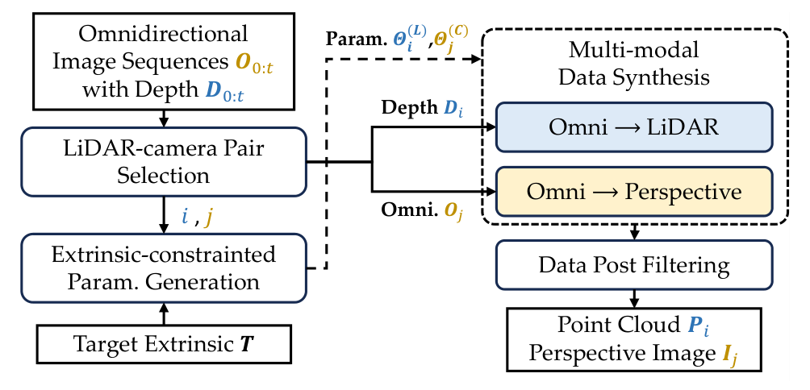
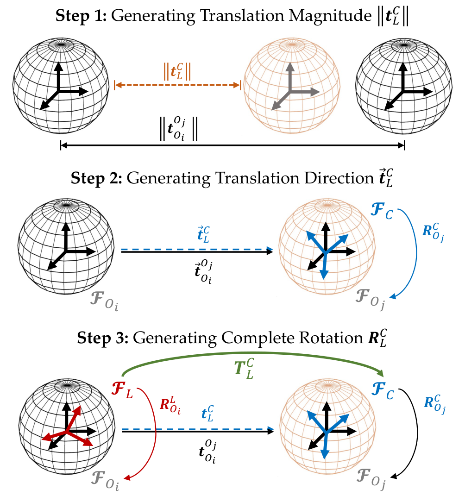

<div align="center">

# SynCalib

### Breaking Dataset Shortcuts in LiDAR-Camera Calibration via Extrinsic-Controllable Synthesis

Huihua Zhu, Shuyang Zhang<sup>†</sup>, Dongqing Chen,
Zhuo Yu, Jianhao Jiao, Yilong Zhu,
Xiaopin Zhong<sup>†</sup>, and Zongze Wu

**Submitted to ICRA 2027**



</div>

SynCalib builds physically consistent training data for online LiDAR-camera extrinsic
calibration. Starting from TartanGround cubemap RGB, packed depth, and ground-truth
poses, it synthesizes perspective images and LiDAR scans whose geometry matches a
controllable target extrinsic. The resulting data avoids the fixed-sensor shortcuts
present in conventional calibration datasets.

## Highlights

- **Extrinsic-controllable synthesis.** Each image, point cloud, and true extrinsic is
  generated from the same simulated geometry rather than by perturbing an existing
  point cloud.
- **Deployment-aligned supervision.** The network starts from a nominal factory
  calibration `T0` and learns the complete left residual from `T0` to the true `Ti`.
- **Multiple sensor profiles.** Different LiDAR models can be configured by adjusting the parameters according to their respective models.
- **Auditable generation.** Scene holdouts, bidirectional overlap, projection quality,
  residual coverage, reuse statistics, resumable progress, and transactional export
  are recorded for every build.

## Pipeline

Given a nominal calibration `T0`, we sample a left residual `delta_Ti` and set the
target extrinsic to `Ti = delta_Ti @ T0`. For each qualified omnidirectional frame
pair, the three steps below construct virtual sensor poses that realize this target
extrinsic exactly.

<p align="center">
  
</p>

1. **Generating translation magnitude.** Use the original frame-pair baseline and
   the target translation magnitude to solve a physical scale. Apply this scale
   consistently to both depth maps and the relative translation, so the virtual
   sensor separation matches the target baseline.
2. **Generating translation direction.** Choose the virtual camera orientation so
   the scaled baseline, expressed in camera coordinates, matches the target
   translation vector. Rotation about the aligned baseline leaves this constraint
   unchanged and provides additional viewpoint diversity within the configured
   camera-orientation constraints.
3. **Generating complete rotation.** With the camera orientation and original
   relative pose known, solve the LiDAR orientation analytically to reproduce the
   target rotation. Rerender the perspective image and query cubemap depth along the
   rotated LiDAR beams to synthesize a physically consistent image–point-cloud pair.

Repeating this construction across sampled `Ti`, frame pairs, and valid viewpoints
produces a dataset with diverse true extrinsics around `T0`. Generated pairs pass
projection-quality checks before export; fixed mode uses the same construction with
`Ti = T0`.

The project uses column vectors and LiDAR-to-camera extrinsics:

```text
p_camera = Ti @ p_lidar
delta_Ti = Ti @ inverse(T0)
delta_Ti @ (T0 @ p_lidar) = Ti @ p_lidar
```

## Installation

The package requires Python 3.8 or newer. Install it in editable mode from the
repository root:

```bash
python -m pip install -e .
```

## Source Data

TartanGround is not distributed with this repository. The source root must contain
complete scene sequences in the original omnidirectional layout:

```text
<TartanGround>/
  <scene>/
    Data_omni/
      P0000/
        image_lcam_<front|right|back|left|top|bottom>/
        depth_lcam_<front|right|back|left|top|bottom>/
        pose_lcam_<front|right|back|left|top|bottom>.txt
```

Depth images must use the original RGBA-packed `float32` PNG representation. Scene
splits are defined before any frame pair, virtual camera, or point cloud is derived.

## Configuration

Each task is self-contained in YAML. The configuration defines the nominal extrinsic,
scene split, camera and LiDAR profiles, pair selection, residual sampler, physical
scale range, quality gates, curriculum, random seed, cache policy, and target sample
count.

| Configuration | Extrinsic mode | Sensor profile |
| --- | --- | --- |
| `fixed_t0_rs32_rectified2048_20x2000.yaml` | Fixed `Ti = T0` | RS32 |
| `fixed_t0_mid360_rectified2048_20x2000.yaml` | Fixed `Ti = T0` | MID-360 |
| `direct_euler_ti_rs32_rectified2048_20x2000.yaml` | Direct-Euler residual | RS32 |
| `direct_euler_ti_mid360_rectified2048_20x2000.yaml` | Direct-Euler residual | MID-360 |
| `direct_euler_ti_kitti_odometry_04_hdl64e_20x2000.yaml` | Direct-Euler residual | HDL-64E |

Beam tables for RS32 and MID-360 are stored beside the YAML files under `config/`.

## Dataset Generation

The command line supplies only the task file and filesystem locations; generation
behavior is controlled by the selected YAML:

```bash
PYTHONPATH=src python scripts/generate_dataset.py \
  --config config/direct_euler_ti_rs32_rectified2048_20x2000.yaml \
  --data-root /path/to/TartanGround \
  --output-root /path/to/output
```

The command refuses to overwrite an existing completed output. Interrupted builds can
be resumed through the same entry point after their configuration and input identity
have been verified.

## Output

Each exported sequence uses a KITTI-style layout with explicit calibration semantics:

```text
<level>/<train|val|test>/<scene>_<trajectory>/
  image_2/
  velodyne/
  calib.txt
  poses.txt
  nominal_extrinsic.txt
  residuals.txt
  metadata.json
```

- `poses.txt` stores the true `Ti` matrices as row-major `3x4` rows.
- `nominal_extrinsic.txt` stores the complete task-level `T0`.
- `residuals.txt` stores `Ti @ inverse(T0)`.
- Point clouds are finite `Nx4 float32` arrays with a zero dummy intensity column.
- `metadata.json` records provenance, sensor profiles, splits, quality metrics,
  residual coverage, reuse audits, rejection statistics, and fingerprints.

Exports declare `training_semantics: nominal_to_true_residual_v1` and
`current_cmrnext_loader_compatible: false`. A training loader must explicitly
implement these semantics before consuming the generated data.

## Code Organization

```text
src/extrinsic_manifold_data/
  pair_pool.py           # source manifests and qualified frame pairs
  sample_generation.py   # target extrinsics and physical candidates
  sensors.py             # camera rendering and LiDAR simulation
  quality_export.py      # quality gates, audits, and transactional export
  generation.py          # public orchestration API
  cli.py                 # command-line entry point
```

The public Python API consists of `GenerationOptions` and
`generate_dataset(options)` from `extrinsic_manifold_data.generation`.

## Acknowledgements

This project builds on the TartanGround simulation dataset and established
LiDAR-camera calibration research, including CalibNet, CMRNext, and the sensor models
and calibration conventions published by KITTI, RoboSense, and Livox. Please follow
the licenses and usage terms of the original datasets and projects.
